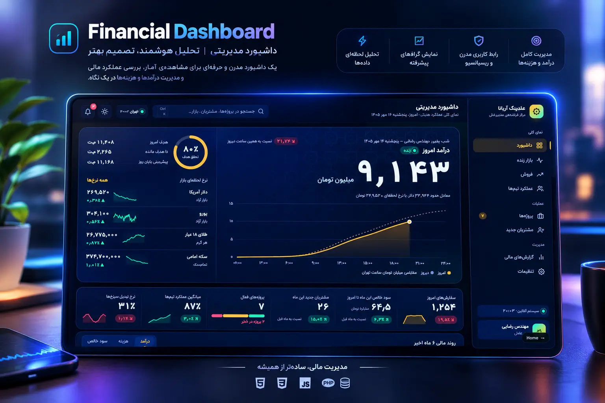

<div align="center">


<br>


</div>

<br>


<br>

<p align="center">
  
</p>

<p align="center">
A single-page executive command center for a holding company: live revenue, a six-month financial trend, sales and team-performance analytics, and a fully themeable, accessible UI — built as one self-contained front end, no framework, no build step.
</p>

<br>


<br>

### ✨ Overview

CEO Dashboard is a portfolio piece simulating the kind of internal tool a holding company's leadership would actually use every day: a single glance at today's revenue against yesterday's, how the business is trending over six months, where the teams stand, and what needs attention — all in one screen, in Persian, right-to-left, and readable on a phone on the way into a meeting.

<br>

### 🧭 Features

- **Live revenue hero** — today's cumulative revenue plotted against yesterday's on a running chart, a pulsing "live" indicator, and a circular progress ring tracking the daily goal
- **KPI ribbon** — the key numbers (profit, growth, orders, and more) rendered as a horizontally scrollable strip of cards
- **Six-month financial trend** — a segmented control lets you switch which metric the chart is plotting, without leaving the page
- **Sales analytics** — order volume over the last six months and an hour-by-hour breakdown of today's orders, side by side
- **Team performance chart** — a scored comparison across teams
- **Cost & profit report** — monthly cost vs. net profit, broken out for the reporting view
- **Full navigation** — Dashboard, Live Market, Sales, Team Performance, Projects (with a live count badge), New Clients, Financial Reports, and Settings, in a sidebar that collapses to icon-only on narrower screens
- **Theme system** — light/dark mode plus four accent palettes (turquoise, violet, ruby, saffron), switchable from Settings and persisted across visits
- **Personalization** — adjustable font size, an animation toggle, auto-save of preferences, and per-channel notification toggles (email, SMS, push, weekly digest)
- **Command search** — a quick search over projects, clients and market data, with a dedicated overlay on mobile
- **Notifications panel** and a **mobile bottom nav** with a "more" sheet for the full menu on small screens
- Built **accessibility-first** — ARIA labels and roles throughout, `role="img"` descriptions on every chart, keyboard-operable controls, and a screen-reader-only page heading
- Fully **responsive** and **RTL-native** (Persian)

<br>


<br>

### 🛠️ Tech Stack

<p align="center">


</p>

No frameworks, no bundler, no backend. Everything — markup, design tokens, and the logic that drives every chart, toggle, and panel — lives in a single `index.html`, with Chart.js pulled in for the data visualizations. Settings are applied before first paint (an inline script reads `localStorage` ahead of render) so there's no flash of the wrong theme on load.

<br>


<br>

### 🎨 Design System

| Token | Default (Turquoise) | Role |
|---|---|---|
| `--bg` | `#050C20` | Base dark surface |
| `--accent` | `#38D9C8` | Primary accent, live indicators, active nav |
| `--accent-2` | `#F5B83D` | Secondary accent, highlights |
| `--on-accent` | `#04201C` | Text/icons on accent-filled surfaces |

Three more accent themes ship out of the box — **Violet** (`#9B8CFF` / `#5ED6C8`), **Ruby** (`#FF6B86` / `#F5B83D`), and **Saffron** (`#F5B83D` / `#38D9C8`) — each with its own light-mode ink variant, switchable live from the Settings panel without a reload.

<br>


<br>

### 🚀 Getting Started

```bash
# just open it — fully client-side, nothing to install
open index.html
```

Or deploy the folder as-is on GitHub Pages or any static host.

<br>


<br>

<div align="center">
<sub>Built by <b>Mohammadreza Asadpour</b> — questions or feedback are always welcome.</sub>
</div>

<br>


